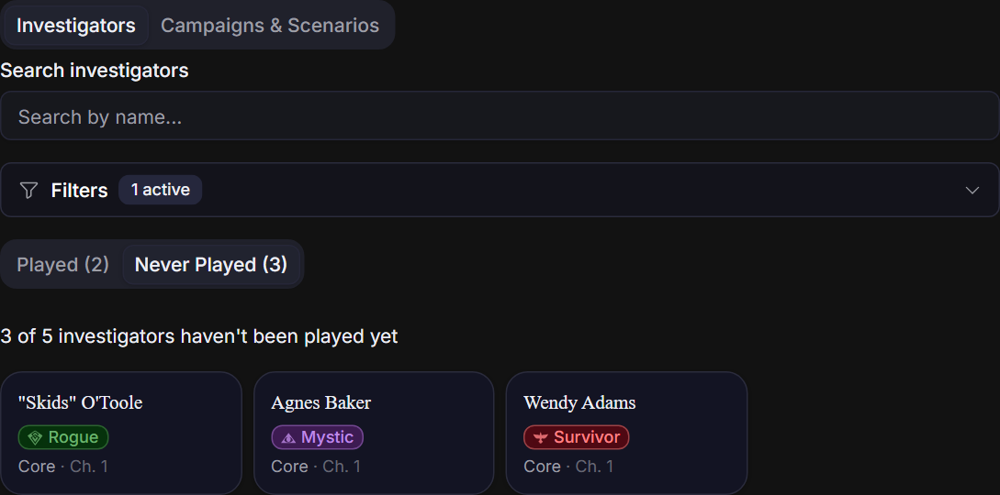
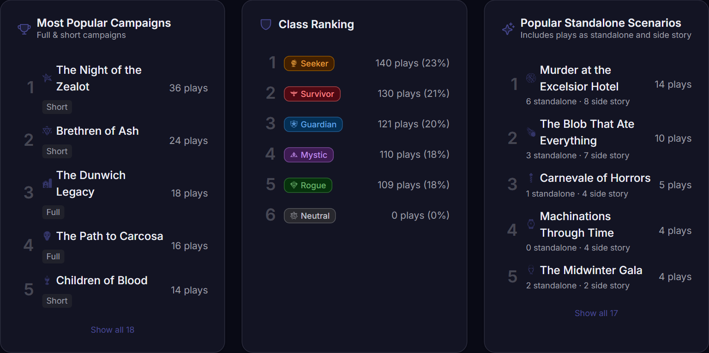

# Arkham Horror LCG Tracker

When your group returns to Carcosa after a month away, pick up the story where you left off. This play journal for *Arkham Horror: The Card Game* keeps track of the investigators you brought, the choices you made, and how each game night ended.

**[Open the tracker](https://arkham-horror-lcg-ca.vercel.app)** · [v1.1.0 release notes](https://github.com/Giffdev/arkham-horror-lcg-ca/releases/tag/v1.1.0) · [Changelog](CHANGELOG.md)

To start a private journal for your table, sign in with Google or email and choose **Log New Campaign**. You can browse the community rankings without an account.

## At the table and between games

### Log a game night

Before you put away the chaos bag, record who played which investigator, the scenario’s resolution, and a note about the choice you want to remember. A night at the *Excelsior Hotel* can be a standalone mystery or a detour in a longer campaign. You can log fan-made adventures, too.

Track **XP earned, physical trauma, and mental trauma for each investigator**. If one investigator earned 4 XP and another earned 3, the log keeps both results. Next time you open the campaign, the roster shows their running totals. Expand a past scenario to see where that XP or trauma came from.

### Find an investigator you haven’t tried

Has anyone at your table played Wendy Adams, or was that a different group? Open **Players** to see which investigators your table has tried. Choose yourself or a friend to see just that person’s **Played** and **Unplayed** lists.

Filter by class, set, or chapter to find someone new in a box you own. In this example, the table has tried two investigators from the Core set; **Never Played** shows the other three.



**Campaigns & Scenarios** answers the same question about adventures. Pick a standalone that’s new to everyone, or open a past campaign to remember who brought which investigator.

### See what other tables are playing

The public rankings show which campaigns, standalone mysteries, investigators, and classes see the most play. If you have just one evening before the group starts a new campaign, the standalone list is a good place to pick your next mystery.



Looking for a partner for your next investigator? In the signed-in **Community** tab, the **Investigator Pairings** heatmap lets you compare the duos from your own game nights with the ones other tables have taken through campaigns.

## Technology

- React 19 and TypeScript
- Vite
- Tailwind CSS and shadcn/ui
- Firebase Authentication and Cloud Firestore
- Vercel serverless functions for trusted community-stat aggregation
- Vitest and Testing Library

## Local development

### Prerequisites

- Node.js 22 (see [`.nvmrc`](.nvmrc) for the pinned version)
- npm
- A Firebase project with Authentication and Cloud Firestore enabled

### Setup

1. Clone the repository:

   ```bash
   git clone https://github.com/Giffdev/arkham-horror-lcg-ca.git
   cd arkham-horror-lcg-ca
   ```

2. Install dependencies:

   ```bash
   npm ci
   ```

3. Copy the environment template:

   ```bash
   cp .env.example .env.local
   ```

4. Add your Firebase web-app configuration to `.env.local`.

5. Start the development server:

   ```bash
   npm run dev
   ```

Vite prints the local URL when the server starts.

## Environment configuration

The client requires the `VITE_FIREBASE_*` values documented in [`.env.example`](.env.example).

`VITE_COMMUNITY_STATS_API_ENABLED` controls whether the browser wakes the community-stat processing endpoint. The server-only community-stat variables are needed only when running or deploying that backend; do not expose service-account credentials through `VITE_*` variables.

## Useful commands

| Command | Purpose |
| --- | --- |
| `npm run dev` | Start the Vite development server |
| `npm test` | Run the Vitest suite |
| `npm run typecheck` | Type-check the frontend and backend; flag unused locals and parameters in the frontend app |
| `npm run build` | Build the backend artifact and production frontend |
| `npm run preview` | Preview the production build locally |
| `npm run test:firestore:unit` | Run Firestore-related unit tests |
| `npm run test:firestore` | Run unit and emulator-backed Firestore tests |

## Deployment

The production application is deployed manually to Vercel; pushing a commit or publishing a GitHub release does not deploy the site. Firebase provides authentication and persistent data storage, while the community-stat endpoint publishes aggregate statistics without exposing individual users' game logs.

See [DEPLOYMENT.md](DEPLOYMENT.md) for the deployment architecture, required server configuration, bootstrap process, and operational checks.

## Contributing

Issues and pull requests are welcome. Before submitting a change, run the most relevant tests along with:

```bash
npm run typecheck
npm run build
```

## Disclaimer

This is an unofficial fan-made tracker. *Arkham Horror: The Card Game* and related names and artwork belong to their respective owners. This project is not affiliated with or endorsed by Fantasy Flight Games.

## License

This repository is available under the [MIT License](LICENSE).
